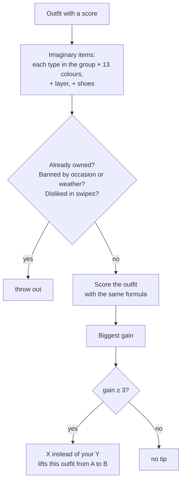

# The "buy this" tip

Under every card in the "Looks" feed there's a "Complete the look" box. It shows one item you don't own: a type and a
colour, an example picture in that colour, and a sentence like "Black jeans instead of your black pants lifts this
outfit from 87 to 97". You can add it to a shopping list or search for it in shops.

## Step by step

### 1. Try every item you don't have

For each outfit shown, the recommendation service tries out imaginary purchases:

1. **Swap an item.** Each item in the outfit is swapped, one at a time, for every item from the same group (top for
   top, bottom for bottom, layer for layer, shoes for shoes) in each of the 13 colours. Type + colour combinations
   you already own are skipped.
2. **Add a layer.** If the outfit has no outer layer, it tries adding a jacket or coat in any colour.
3. **Shoes.** If the outfit has no shoes at all, it always suggests the pair that gives the best score, even if the
   gain is tiny, because an outfit without shoes isn't complete.

Every option is scored with **the same formula** as the outfit itself ([recommendations.md](recommendations.md)),
with the same weather, occasion and taste.

### 2. What gets thrown out

- items banned by the occasion or the weather (it won't tell you to buy shorts for a job interview, or light shoes
  for rain);
- types and colours you dislike on balance, according to your swipes ([taste.md](taste.md));
- skirts and dresses in the men's feed;
- in the cold, options without a warm layer.

### 3. What wins

The **one** purchase that raises the outfit's score the most wins, as long as it raises it by at least 3 points. If
nothing gives +3, there's no tip: there's no point buying something for one extra point.

### 4. Example with numbers

From the example in [recommendations.md](recommendations.md): casual occasion, +12 °C, windy, the outfit "white
T-shirt + black trousers (too loose) + white shoes" scored 86.9.

The best purchase is **black jeans instead of the black trousers**:

| | Before (trousers) | After (jeans) | Why |
|---|---|---|---|
| Occasion | 76.7 | 93.3 | jeans (dressiness 2) match the occasion; the trousers (4) were too dressy |
| Weather | 92 | 92 | same warmth |
| Colours | 100 | 100 | same colour |
| Taste | 0 | +0.8 | the user likes jeans |
| Style | −1 | +2 | the loose-fit penalty is gone; "light and dark balance" stays |
| **Total** | **86.9** | **97.3** | **+10.4** |

For the outfit "T-shirt + jeans + shoes" (96.2) the tip is different: "A blue jacket on top lifts this outfit from
96 to 100". The layer removes the wind penalty, and the user likes blue. They already own a navy jacket, so that one
isn't suggested.

### 5. What you see

- The picture is an example of that item type, tinted to the right colour on the page. There's no product catalogue
  and no prices.
- The link searches for the item in shops. The search only contains the colour, the type and "men / women", nothing
  about you.
- The shopping list lives only in your browser.

## Diagram

## Where this is in the code

- Picking the purchase (`suggest_purchase`, the `MIN_GAIN` threshold):
  [recommendation-service/app/engine/recommend.py](../../fitcast/recommendation-service/app/engine/recommend.py)
- The "Complete the look" card, the shop search link, the shopping list: [frontend/app/looks/page.tsx](../../fitcast/frontend/app/looks/page.tsx)
- Example pictures for each type: [frontend/public/shop](../../fitcast/frontend/public/shop)
