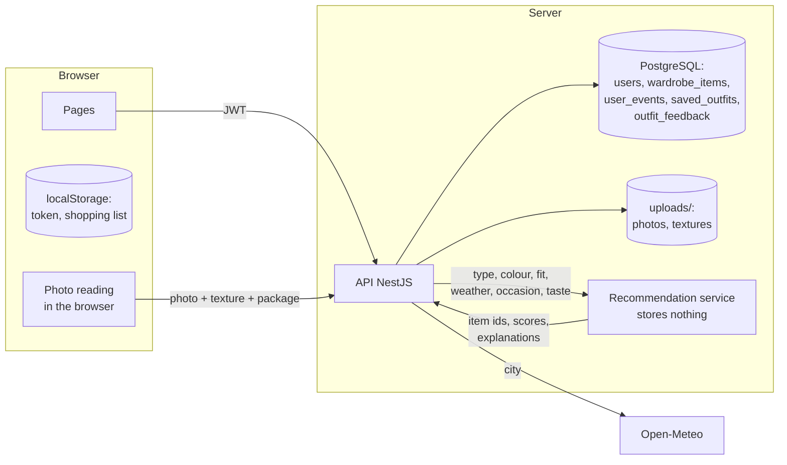

# What is stored and how the parts talk

You see your profile, wardrobe, events, saved outfits and swipe history, and they're all still there when you log
in again from any device. Only the shopping list and your login stay in the current browser. Below is what lives
where and who sends what to whom.

## Step by step

### 1. What's in the database (PostgreSQL)

| Table | What it holds | Notes |
|---|---|---|
| `users`: a user | email, name, city, bio, admin flag | the password is stored only as a hash (bcrypt); `sessionVersion` makes old logins stop working after a password change |
| `wardrobe_items`: an item | type, main colour (one of 13), fit, photo path | `garment_3d`: the 3D garment package (points, rows, exact colour, review flags); `texture_url`: the cut-out print; `attributes`: pattern, second colour, sleeve, tone |
| `user_events`: an event | name, occasion, start time, city (empty = profile city), note | the forecast isn't stored; it's fetched on every request |
| `saved_outfits` + `outfit_items`: a saved outfit | name, occasion, event, the service's explanation, list of items | if the event is deleted, the outfit stays and just loses the link |
| `outfit_feedback`: a swipe | the outfit's items, like / dislike, occasion or event, temperature, precipitation, score | one verdict per outfit per occasion or event |

Deleting a user deletes all their items, events, outfits and swipes.

### 2. What's stored outside the database

- **Item photos and textures**: files on the API's disk (the `uploads/` folder, a separate volume in Docker). File
  names are random, and the file type is checked by its content.
- **3D figures**: static files of the website (`frontend/public/models`). No user data in them.
- **In the browser**: the login token and the shopping list (localStorage).
- **In the API's memory**: the weather cache (city coordinates 24 hours, forecasts 30 minutes).

### 3. Who talks to whom

1. **Browser → API.** Every request goes over HTTP with a login token (JWT). The API makes sure you only touch your
   own items, events and outfits.
2. **The browser itself** reads the photo (mask, type, colour, pattern). It sends the photo, the texture and the 3D
   garment package to the server, and the server checks the package again in full: it doesn't trust the browser.
3. **API → Open-Meteo.** The city name and coordinates, nothing about you.
4. **API → recommendation service.** An internal HTTP request. The API reads your items from the database and sends
   only what the rules need:
   - items: id, type, colour, fit, and if known, pattern, second colour and sleeve;
   - weather: temperature, precipitation, wind, local hour;
   - the occasion;
   - your taste (type and colour weights) and your swipe history;
   - items from outfits you saved this week;
   - outfits you already judged, so they aren't repeated.

   Your email, password, photos and tokens never go to the service. The service stores nothing and never touches
   the database: it answers each request from scratch.
5. **Service → API → browser.** Outfits (lists of item ids), the score and its breakdown, the explanation, the buy
   tip. The API marks which ones you've already liked or saved, and hides the ones you disliked.
6. **3D module → website.** Not while the site runs, but when it's built: figures are copied into the site with
   `npm run figure:sync`.

## Diagram

## Where this is in the code

- Database schema: [fitcast/prisma/schema.prisma](../../fitcast/prisma/schema.prisma), migrations:
  [fitcast/prisma/migrations](../../fitcast/prisma/migrations)
- Login and tokens: [src/auth](../../fitcast/src/auth)
- Wardrobe, file uploads, package check: [src/wardrobe](../../fitcast/src/wardrobe)
- The request to the recommendation service: [src/recommendations/recommendations.service.ts](../../fitcast/src/recommendations/recommendations.service.ts)
- The format of that request: [recommendation-service/app/models/schemas.py](../../fitcast/recommendation-service/app/models/schemas.py)
- Every request the site makes: [frontend/lib/api.ts](../../fitcast/frontend/lib/api.ts)
- How the containers start: [docker-compose.yml](../../fitcast/docker-compose.yml)
