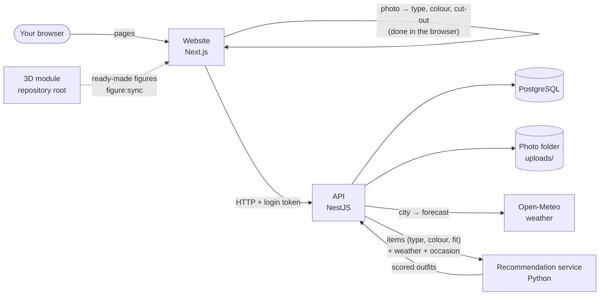

# How FitCast works

FitCast is a wardrobe website. You take photos of your clothes, one item at a time. The site works out what each
item is (T-shirt, jeans…), its colour, whether it has a pattern and how long the sleeves are. It shows your clothes
on a 3D mannequin and puts together outfits from your wardrobe for the occasion and the weather. It learns what you
like from your swipes, and it tells you which one item to buy to make an outfit better.

## The big picture



- **Website** (`fitcast/frontend`) shows the pages. It also reads your clothing photos right in the browser, so the
  photo is never sent anywhere for recognition.
- **API** (`fitcast/src`) handles login, the wardrobe, events, weather and saved outfits. It is the only part that
  talks to the database and the weather service.
- **Recommendation service** (`fitcast/recommendation-service`) gets a short description of your items (type,
  colour, fit, pattern) plus the weather and occasion. It builds outfits and scores them. It never sees the
  database, your password or your photos.
- **3D module** (repository root, `imported-body/`) prepares the dressed 3D figures ahead of time and checks them.
  The website gets them as ready-made files.

## Details

| Page | What it explains |
|---|---|
| [User flow](user-flow.md) | from sign-up to a finished outfit, with screenshots |
| [What happens to a photo](photo.md) | type, colour, sleeve, pattern, cutting out the print |
| [Clothes on the 3D mannequin](mannequin.md) | ready-made figures, body sliders, putting the print on |
| [Weather and events](weather-events.md) | where the weather comes from, how wind, time and occasion count |
| [Recommendations](recommendations.md) | how an outfit is built and scored, with a worked example |
| [Taste](taste.md) | how the app learns from your swipes |
| [Buy advice](buy-advice.md) | how the "buy this one item" tip is chosen |
| [Data](data.md) | what is stored and how the parts talk to each other |
| [Limitations](limitations.md) | what the app can't do |

## How to run it

All you need is Docker Desktop:

```powershell
cd fitcast
docker compose up --build -d
```

Open http://localhost:3001. To get a demo user with a ready wardrobe, run
`docker compose exec api node scripts/seed-demo.cjs`. More in
[fitcast/docs/ONBOARDING.md](../../fitcast/docs/ONBOARDING.md).

## Where this is in the code

- Website: [fitcast/frontend/app](../../fitcast/frontend/app)
- API: [fitcast/src](../../fitcast/src)
- Recommendation service: [fitcast/recommendation-service/app/engine](../../fitcast/recommendation-service/app/engine)
- 3D module: [imported-body](../../imported-body)
- How everything starts together: [fitcast/docker-compose.yml](../../fitcast/docker-compose.yml)
