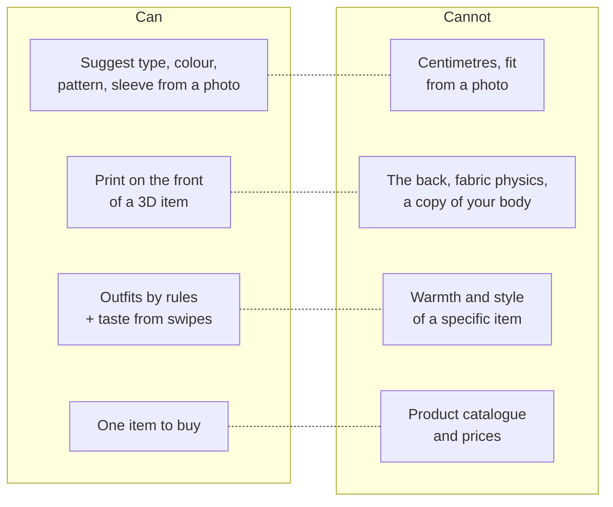

# What the app can't do

FitCast suggests, it doesn't decide for you. Anything the site "saw" in a photo you can correct, and outfit scores are
points from rules, not a measured accuracy. Here is an honest list of what the app doesn't do, or does with caveats.

## Step by step

### Photos and recognition

- **The item type is a suggestion.** On the project's 26 test photos it was right first time on 23. The shape rules
  (two legs, sleeves, widening towards the bottom) were tuned on those same photos, so on new photos it may do
  worse. You always confirm the type.
- **Pattern** was right on 15 of 19 test photos. Small or faint prints get missed.
- **Fit** ("fits well / too tight / too loose") isn't detected. You set it yourself.
- **No centimetres.** A photo has no scale, so the item's size isn't measured.
- For outfit matching, the colour is rounded to one of 13 colours. The exact colour is only kept for 3D.
- Photo reading runs on the browser's main thread, so the page freezes for about 2 seconds.
- You can't fix the points on trousers by hand (you can on tops).

### 3D mannequin

- **It isn't a digital copy of you.** The figure is a ready-made model from a catalogue. The sliders change its shape,
  but don't match it to your real measurements.
- **The print is only on the front.** The back and sides are painted in the item's main colour. They aren't
  rebuilt from the photo.
- **No fabric physics.** The item is the figure's own clothing with your print on it, not a separately sewn mesh put
  on the body. The site doesn't show how the item would really fit.
- **Not everything has a figure.** Shorts, skirts and dresses don't go onto the 3D model, and the site says there's
  no model for them yet. The women's hoodie failed the clipping check and was left out of the catalogue.
- "Realistic proportions" (height and weight shape the whole figure) are based on men's measurements, so the mode is
  off for the women's figure.

### Recommendations and taste

- **Item properties come from the type only.** A light jacket and a down jacket look the same to the service, and so
  do trainers and dress shoes. Items have no warmth, season or style of their own.
- **The formula's weights** (40 / 35 / 25, the penalties and bonuses) were chosen by hand, not learned from data.
- **The taste model hasn't been tested on people.** It has only been tested on a made-up user (at least 85 % of
  held-back outfits guessed right). It switches on from 8 swipes with both likes and dislikes. It's a small logistic
  regression, not a neural network.
- Taste only learns from whole outfits built from your wardrobe. There's no style quiz.
- **Weather** comes from a 16-day forecast. Events further away don't get outfits.

### "Buy this" tip

- The tip is a type and a colour with an example picture and a shop search link. There's no product catalogue, no
  prices and no stock information.
- The shopping list lives only in your browser and doesn't move to other devices.

### Other

- No email confirmation, no password reset, no social login.
- Photos are stored on the server's disk, not in the cloud.
- The men's / women's feed is a filter in the feed, not a profile setting.
- The recommendation service has no login of its own, so only the API should be able to reach it (in Docker it only
  listens on the local address).

## Diagram

## Where this is in the code

- Limitations listed at hand-in (in Russian): [SUBMISSION.md](../../SUBMISSION.md), "Ограничения" section
- Known debt: [fitcast/docs/ONBOARDING.md](../../fitcast/docs/ONBOARDING.md), section 8
- What the photo → 3D path doesn't do (in Russian): [imported-body/docs/PIPELINE.md](../../imported-body/docs/PIPELINE.md)
- Item properties by type: [catalog.py](../../fitcast/recommendation-service/app/engine/catalog.py)
- Checking the taste model: [recommendation-service/README.md](../../fitcast/recommendation-service/README.md)
