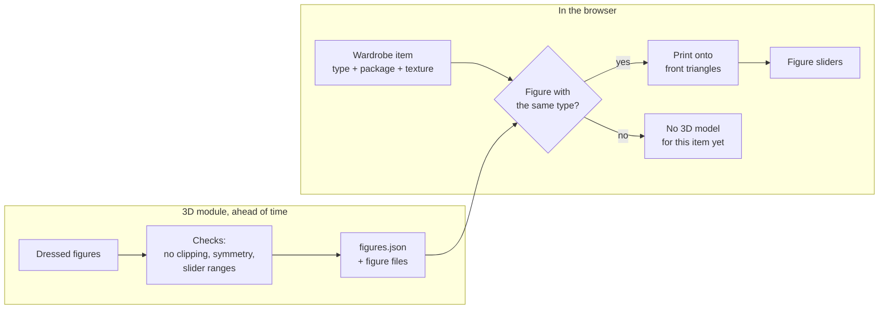

# How an item gets onto the 3D mannequin

In the fitting room you see a dressed figure. The print from your T-shirt or trousers photo is on the front of the
clothes. You can rotate the figure, change it with sliders (height, chest, waist, hips, shoulders, arms, legs) and
switch between men's and women's figures. The same figures appear in the outfit feed: the top and bottom are tinted
in the outfit's colours, and items with a photo show their print.

## Step by step

### 1. Ready-made dressed figures

The mannequin is not built from a photo of you, and it isn't made from scratch for each item. There is a catalogue
of 35 prepared low-poly figures: 16 men's and 19 women's. Each one is already dressed: T-shirt, shirt, hoodie,
sweater, cardigan, blazer, jacket, coat, turtleneck, blouse and so on, plus trousers. Each figure is split into
parts (head, arms, top, bottom, shoes), so the site knows where the top and the trousers are.

The 3D module at the repository root prepares the figures. Before a figure reaches the site it passes automatic
checks: the clothes don't poke through the body, left and right halves match, the sliders don't break the mesh. The
figures are copied to the site as ready files with `npm run figure:sync`.

### 2. Picking a figure for an item

An item only goes onto a figure wearing **the same type** of clothing: a T-shirt onto a figure in a T-shirt, a hoodie
onto a figure in a hoodie, trousers onto a figure in trousers. The list of figures and what they wear is in
`figures.json`. If there is no matching figure (shorts, skirts, dresses), the site says so and puts nothing on.

### 3. Fitting to the body (sliders)

- The sliders move the body **together with the clothes**, because the clothes are part of the same mesh.
- Every change is worked out again from the original figure, not from the last state, so errors don't pile up.
- Each figure has a measured safe range for every slider. Beyond it the clothes would start folding into themselves,
  so the site doesn't let you go there.
- "Realistic proportions" mode: you set height and weight, and the other measurements follow, based on real body
  measurements (the ANSUR II dataset, 4082 men). For example, at the same weight a bigger chest comes with a
  slightly bigger waist. The data is for men only, so this mode is off for the women's figure, where you use the
  sliders directly.
- The figure shows no centimetres: it isn't calibrated. Only the ratios come from the data.

### 4. Putting the print on

1. The figure's clothes have no ready texture layout, so the site works out a photo position for every triangle on
   the front of the item.
2. The front of a top is laid out in rows: hem → waist → chest → armpit → shoulders and neckline. The edges of each
   row come from the photo's key points and mask ([photo.md](photo.md)). Sleeves go from shoulder to cuff. For
   trousers, the seat and each leg are laid out separately.
3. The photo is taken from the front, so the right side of the picture is the wearer's left. This is handled, so
   the item isn't mirrored.
4. Positions are worked out on the original figure, so when you move the sliders the print moves with the fabric and
   doesn't slide around.
5. **The back and sides** aren't in the photo, so they are simply painted in the item's main colour. The back is not
   guessed and not copied from the front.

## Diagram

## Where this is in the code

- Fitting room: [fitting/FittingRoom.tsx](../../fitcast/frontend/app/fitting/FittingRoom.tsx),
  [fitting/FigureViewer.tsx](../../fitcast/frontend/app/fitting/FigureViewer.tsx)
- Mannequin in the outfit feed: [looks/OutfitFigure.tsx](../../fitcast/frontend/app/looks/OutfitFigure.tsx)
- List of figures: [public/models/figures.json](../../fitcast/frontend/public/models/figures.json)
- Sliders: [lib/figure/deform.ts](../../fitcast/frontend/lib/figure/deform.ts), realistic proportions:
  [lib/figure/proportions.ts](../../fitcast/frontend/lib/figure/proportions.ts)
- Putting the print on: [lib/figure/photoMap.ts](../../fitcast/frontend/lib/figure/photoMap.ts) (an exact copy of
  [imported-body/src/photoMap.ts](../../imported-body/src/photoMap.ts), which is checked in the 3D module)
- Preparing and checking figures: [imported-body](../../imported-body), status (in Russian):
  [imported-body/docs/STATUS.md](../../imported-body/docs/STATUS.md)
- Copying figures to the site: [fitcast/scripts/sync-figure.cjs](../../fitcast/scripts/sync-figure.cjs)
