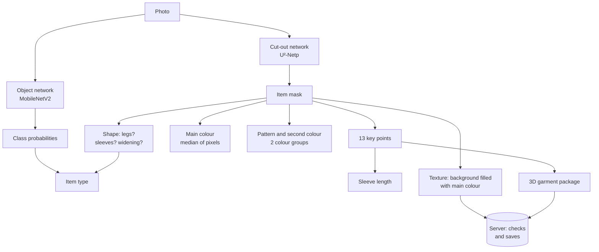

# What happens to an uploaded photo

You pick a photo of an item. A couple of seconds later the form has picked the type ("T-shirt, recognized from the
photo, please check"), marked the main colour, and noted what else it sees: plain or patterned, a second colour,
sleeve length. For T-shirts, shirts, hoodies, sweaters and trousers the site also cuts the item out of the
background, so its print can go onto the 3D mannequin later. All of this runs in your browser, and the photo is not
sent anywhere for recognition.

## Step by step

### 1. Two small neural networks look at the photo

The photo is checked (JPEG, PNG or WebP, up to 8 MB) and made smaller. Then two small neural networks run side by
side, both in the browser:

- **the cut-out network** (U²-Netp) decides, for every pixel, "item or background". The result is called a
  **mask**;
- **the object network** (MobileNetV2, trained on ImageNet) says what the photo looks like, out of 1000 classes.
  About 30 of those are clothes: "T-shirt", "cardigan", "jeans", "trench coat", "miniskirt", "running shoe" and so on.

### 2. Item type

1. Each clothing class from ImageNet is linked to a type on the site. For example "jersey, T-shirt" → T-shirt,
   "trench coat" → coat, "jean, denim" → jeans.
2. The class probabilities are added up per type. The type with the biggest total is the suggestion.
3. **Shape check.** The network looks at fabric, not shape, so it may call a blue knitted top "jeans". The mask
   fixes this:
   - two legs with a gap at the bottom → trousers, jeans or shorts;
   - no gap, but sleeves sticking out at the top → a top, not trousers;
   - no sleeves, no legs, and it gets wider towards the bottom → a skirt.
4. If one type is clearly ahead (at least 35 % and twice the runner-up), the form picks it. Otherwise it offers
   options as buttons ("Or: Shirt, Sweater"). If nothing looks like clothing, no type is suggested.

On the project's 26 test photos the type was right first time on 23, and on 2 more the right answer was among the
options. It is a suggestion: you always confirm the type.

### 3. Main colour

The site takes the pixels inside the mask and trims the edge so no background sneaks in. It drops the darkest 5 % and
the brightest 5 % (shadows and highlights) and takes the middle value (the median). That is the exact colour, for
example `#e8e4dc`. For outfit matching it is rounded to the nearest of 13 colours: black, white, gray, beige, brown,
red, orange, yellow, green, blue, navy, purple, pink.

### 4. Pattern and second colour

1. The item's pixels are split into two colour groups (2-means clustering in Lab colour space, where distance
   matches how different colours look to people).
2. If the two groups are very different (more than 40 ΔE apart) and the smaller one covers at least 5 % of the
   item, it's a pattern: stripes, checks, a print. Folds and shadows on a plain item give two close groups, so they
   don't count.
3. If the smaller group is big enough, its colour becomes the item's second colour.
4. The site also notes the tone: light, mid or dark.

On 19 test photos the pattern was right on 15. Small or faint prints get missed.

### 5. Sleeve length

For tops, the site finds 13 key points on the mask: collar, shoulders, armpits, cuffs, hem corners. It divides the
sleeve length (armpit to cuff) by the shoulder width. 0.45 or more means long sleeve, less means short. On the test
photos T-shirts came out at 0.16–0.36 and long sleeves at 0.53–0.64.

### 6. Cutting out the print

1. The mask is cleaned up: keep the biggest piece, close small holes, and give back background the network grabbed
   by mistake (the wall between trouser legs, fabric under the hem).
2. The site makes a **texture**: the photo itself, with everything outside the mask filled with the item's main
   colour. That way no background shows up on the 3D item.
3. The key points and the item's edges at the hem, waist, chest and armpit lines are saved in a "3D garment
   package". This is what places the print on the mannequin later ([mannequin.md](mannequin.md)).
4. If the points look wrong (sleeves hanging down along the body, item cut off by the photo edge), the form offers
   "Adjust points": you drag them with the mouse or a finger. Without that, the item is saved with a "needs review"
   flag.

### 7. What goes to the server

The photo (for the wardrobe card), the texture and the 3D garment package. The server doesn't trust the browser: it
checks every field of the package, checks the file by its content, and sets the "needs review" flag itself.

## Diagram

## Where this is in the code

All in [fitcast/frontend/lib/garment](../../fitcast/frontend/lib/garment):

- mask and putting it all together: [analyze.ts](../../fitcast/frontend/lib/garment/analyze.ts),
  mask clean-up: [maskOps.ts](../../fitcast/frontend/lib/garment/maskOps.ts)
- type from the photo: [category.ts](../../fitcast/frontend/lib/garment/category.ts) (runs the network),
  [garmentType.ts](../../fitcast/frontend/lib/garment/garmentType.ts) (classes → types, shape check),
  [shape.ts](../../fitcast/frontend/lib/garment/shape.ts) (outline)
- main colour: [color.ts](../../fitcast/frontend/lib/garment/color.ts)
- pattern, second colour, tone: [attributes.ts](../../fitcast/frontend/lib/garment/attributes.ts)
- key points: [landmarks.ts](../../fitcast/frontend/lib/garment/landmarks.ts), sleeve length:
  [look.ts](../../fitcast/frontend/lib/garment/look.ts)
- the add-item form: [profile/Wardrobe.tsx](../../fitcast/frontend/app/profile/Wardrobe.tsx)
- server-side package check: [src/wardrobe/garment3d.ts](../../fitcast/src/wardrobe/garment3d.ts)
- the full photo → 3D path (in Russian): [imported-body/docs/PIPELINE.md](../../imported-body/docs/PIPELINE.md)
