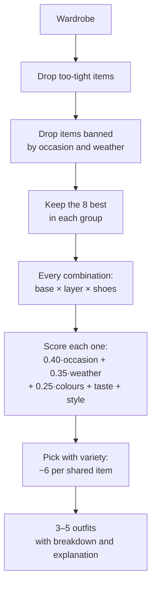

# How an outfit is built and scored

You pick an occasion (or an event) and get 3–5 outfits from your own wardrobe. Each outfit has a score from 0 to 100
("98 match") and a breakdown under it: occasion, weather, colours, plus short notes like "+3 complementary colors"
or "−5 sporty and dressy pieces mixed". Below that is one sentence explaining it, for example: "Casual, +12 °C: navy
jacket over a white T-shirt and blue jeans, white shoes; neutral base with a blue accent".

A separate recommendation service builds the outfits. It isn't a neural network. It's a set of simple rules plus a
small learning model for your taste ([taste.md](taste.md)). The service only sees a description of your items
(type, colour, fit, pattern, sleeve), the weather and the occasion. It never gets your photos or personal data.

## Step by step

### 1. Which items take part

1. **Too-tight items** (fit set to "too tight") are never used. The site tells you how many were skipped. Too-loose
   items are used, but cost points (see below).
2. **Occasion bans.** Each occasion has banned types. A job interview bans hoodies, shorts, T-shirts and jeans. The
   gym bans shirts, blazers, coats, jeans and so on. A wedding guest can't wear white.
3. **Weather bans**: no shorts below +10 °C; no sweaters, hoodies, cardigans, jackets or coats from +25 °C; no coat
   from +20 °C; no light shoes in rain or snow.
4. **In the men's feed** skirts and dresses are left out.
5. In each group (top, bottom, dress, outer layer, shoes) the 8 items that suit the occasion best are kept, so the
   number of combinations stays small.

### 2. How an outfit is put together

- **Base:** top + bottom, or a dress.
- **Outer layer:** none; one layer; a cardigan under a jacket or coat; or a blazer under a coat. A jacket doesn't go
  over a blazer. Below +5 °C a jacket or coat is a must. If you don't own one, the service says there are no outfits
  rather than bending the rule.
- **Shoes:** one pair. If you have no shoes at all, the outfit is built without them and the site tells you.

Every combination is tried, and each one gets a score.

### 3. What the score is made of

```
score = 0.40 × occasion  +  0.35 × weather  +  0.25 × colours  +  taste  +  style
```

Occasion, weather and colours are each scored 0–100. Taste adds between −10 and +10 points, style between −12 and
+12. The total is kept between 0 and 100.

**Occasion (40 %).** Each occasion has a dressiness level from 1 to 5 (casual 2, business meeting 4, job interview
4.5, formal event 5). So does each item type (hoodie 1, T-shirt and jeans 2, sweater 3, shirt and trousers 4,
blazer 5).

- Each item gets `100 − 25 × |item dressiness − occasion dressiness|`. Shoes always get 80, because the type alone
  can't tell trainers from dress shoes.
- An item outside the occasion's palette (business occasions want calm colours) loses 20.
- The item scores are averaged.
- If the occasion has preferred items (job interview: blazer, shirt, trousers), then
  `occasion = 0.8 × average + up to 20 points` for how many preferred types the outfit has.
- For dressy occasions (level 4 and up) each patterned item costs another 8 points.

**Weather (35 %).** Each item type has a warmth from 0 to 3 (T-shirt 1; sweater, jeans and jacket 2; coat 3). The
total warmth is compared with what the temperature needs (details in [weather-events.md](weather-events.md)).

- Being off by 1 is free. Each step beyond that costs 25 points.
- Rain or snow without a jacket or coat: −20.
- Below +3 °C without a coat: −10.
- Strong wind and no layer: −8.

**Colours (25 %).** Neutral colours (black, white, gray, beige, navy) go with everything and don't count.

- 0 or 1 other colour: 100 points; 2: 85; 3: 60; more: 35.
- Each colour beyond three costs another 5.
- Each pair of bright colours costs 30 points (15 on occasions where bright is fine: party, gym, date).
- A patterned item also brings its second colour into the count.

**Taste (±10).** How much you liked these types and colours, and what your personal model says. Details in
[taste.md](taste.md).

**Style (±12).** The notes you see under the score:

| Note | Points | When |
|---|---|---|
| neighbouring / complementary colors | +3 | colours next to each other or opposite on the colour wheel |
| colors that fight | −4 | colours 60–135° apart on the colour wheel |
| sporty and dressy pieces mixed | −5 | items 3 or more dressiness levels apart (hoodie with a blazer) |
| light and dark balance | +2 | light top with a dark bottom, or the other way round |
| `<colour>` head to toe | −3 | top and bottom in the same bright colour |
| dark for the evening / light for an evening out | +3 / −2 | after 18:00 on evening occasions |
| worn this week | −3 per item, up to −6 | item from an outfit you saved this week |
| two patterns compete | −5 | two patterned items |
| a loose piece | −3 per item (−6 on dressy occasions), up to −9 | item with fit "too loose" |
| light shoes in the rain | −5 | light shoes in rain when there are no others |
| short sleeves… | −5 / +2 | short sleeve with no layer: below +12 °C / from +25 °C |
| wind | 0 | just an explanation: the wind is already counted in weather |

### 4. Which outfits you get to see

1. All outfits are sorted by score.
2. Outfits are picked one at a time. While picking, each candidate loses **6 points for every item it shares with an
   outfit already picked**. This stops you getting five versions of the same shirt.
3. The picked outfits are shown best first, with their real scores (the temporary penalty isn't shown).
4. Outfits you already swiped left on for this event are not shown again.

## Worked example

Casual occasion, daytime (14:00), +12 °C, no rain, wind 25 km/h. So far the user has liked jeans and the colour
blue, and doesn't like sweaters or red.

| # | Item | Dressiness | Warmth | Fit |
|---|---|---|---|---|
| 1 | white T-shirt, short sleeve | 2 | 1 | good |
| 2 | red sweater | 3 | 2 | good |
| 3 | blue jeans | 2 | 2 | good |
| 4 | black trousers | 4 | 2 | **too loose** |
| 5 | white shoes | — | — | good |
| 6 | navy jacket | 2 | 2 | good |
| 7 | gray hoodie | 1 | 2 | **too tight** |

Right away: the hoodie is too tight and is left out ("1 item(s) tagged as too tight were not used"). The casual
occasion has dressiness 2, with no preferred items and no palette.

Let's take apart the outfit **"white T-shirt + black trousers + white shoes"**. The service scored it **86.9**.

**Occasion = 76.7.**
- T-shirt: 100 − 25 × |2 − 2| = 100.
- Trousers: 100 − 25 × |4 − 2| = 50. They're too dressy for casual.
- Shoes: 80.
- Average: (100 + 50 + 80) / 3 = **76.7**.

**Weather = 92.**
- Wind 25 km/h at +12 °C: treat it as 2 °C colder, so +10 °C. At +10 °C you need warmth 4.
- The outfit's warmth: T-shirt 1 + trousers 2 = 3. Off by 1, which is free → 100.
- No layer, and it's windy: −8 → **92** (note "windy: a layer would help").
- Short sleeve, but +12 °C is exactly on the line, so no sleeve penalty.

**Colours = 100.** White, black, white: all neutral, no other colours → **100**.

**Taste = 0.** The user has no opinion yet on T-shirts, trousers, shoes, white or black.

**Style = −1.**
- White top, black bottom: "light and dark balance", +2.
- Loose trousers, not a dressy occasion: "a loose piece", −3.
- Total **−1**.

**Total:** 0.40 × 76.7 + 0.35 × 92 + 0.25 × 100 + 0 − 1 = 30.7 + 32.2 + 25 − 1 = **86.9**.

### Compared with other outfits from the same wardrobe

| Outfit | Occasion | Weather | Colours | Taste | Style | **Total** | Why |
|---|---|---|---|---|---|---|---|
| T-shirt + jeans + jacket + shoes | 95 | 100 | 100 | +1.2 | 0 | **99.2** | all casual; the jacket covers the wind (warmth 5 vs 4 needed); the user likes jeans and blue |
| T-shirt + jeans + shoes | 93.3 | 92 | 100 | +1.7 | 0 | **96.2** | same without the jacket: −8 for wind |
| T-shirt + trousers + jacket + shoes | 82.5 | 100 | 100 | 0 | −1 | 92.0 | good, but **not shown** (see below) |
| T-shirt + trousers + shoes | 76.7 | 92 | 100 | 0 | −1 | **86.9** | taken apart above |
| sweater + jeans + shoes | 85 | 92 | 55 | −0.8 | 0 | 79.1 | red and blue are two bright colours: 85 − 30 = 55; the user dislikes sweaters and red |

The user was shown three outfits: 99.2, 96.2 and 86.9. The 92.0 outfit didn't make it because of the variety rule.
It shares three items with the first outfit (T-shirt, jacket, shoes), so while picking it counted as
92 − 3 × 6 = 74. The 86.9 outfit shares only two items with each picked outfit, so it counted as 86.9 − 2 × 6 = 74.9
and won.

The 86.9 outfit also comes with a buy tip: "Black jeans instead of your black pants lifts this outfit from 87 to
97". Why exactly that one is explained in [buy-advice.md](buy-advice.md).

## Diagram



## Where this is in the code

- Building, bans, scoring, picking: [recommendation-service/app/engine/recommend.py](../../fitcast/recommendation-service/app/engine/recommend.py)
  (weights in `WEIGHTS`; functions `outfit_occasion`, `weather_score`, `color_score`, `evaluate`, `recommend`)
- Tables of dressiness, warmth, occasions and colours: [catalog.py](../../fitcast/recommendation-service/app/engine/catalog.py)
- Style notes: [factors.py](../../fitcast/recommendation-service/app/engine/factors.py)
- Request and response format: [app/models/schemas.py](../../fitcast/recommendation-service/app/models/schemas.py),
  described in [recommendation-service/README.md](../../fitcast/recommendation-service/README.md)
- Tests of the rules: [tests/test_engine.py](../../fitcast/recommendation-service/tests/test_engine.py),
  [tests/test_factors.py](../../fitcast/recommendation-service/tests/test_factors.py)
- How the API builds the request: [src/recommendations/recommendations.service.ts](../../fitcast/src/recommendations/recommendations.service.ts)
