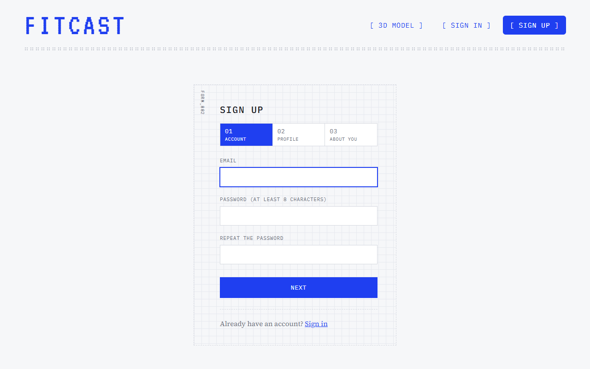
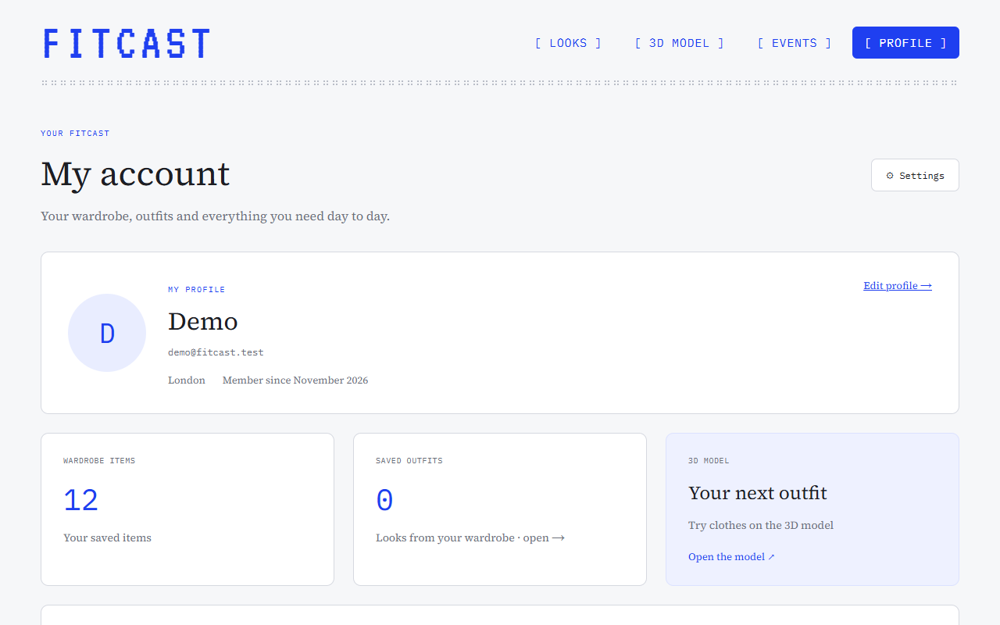
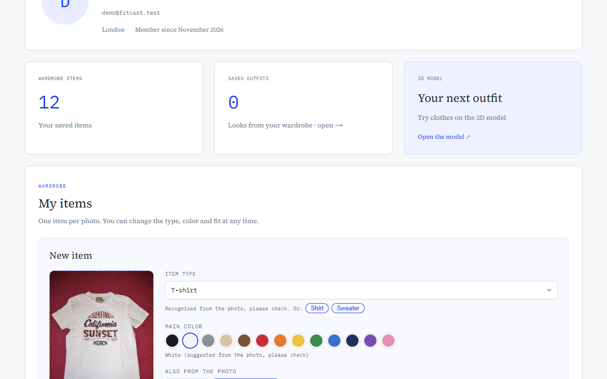
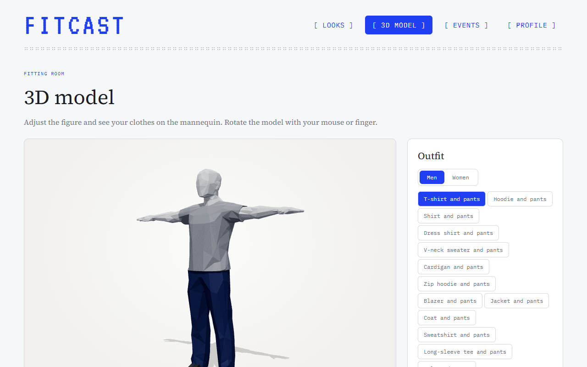
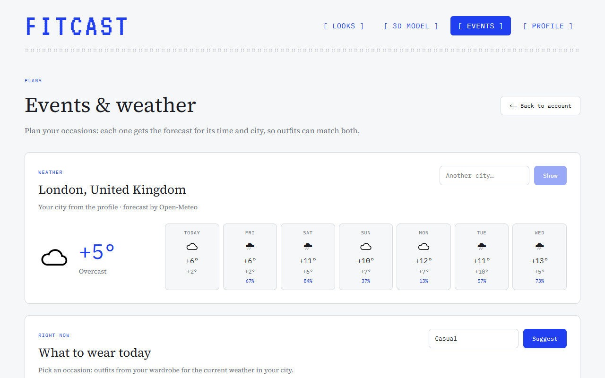
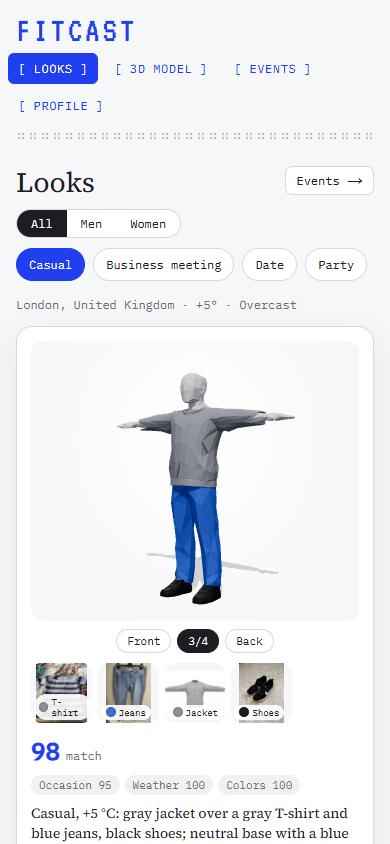
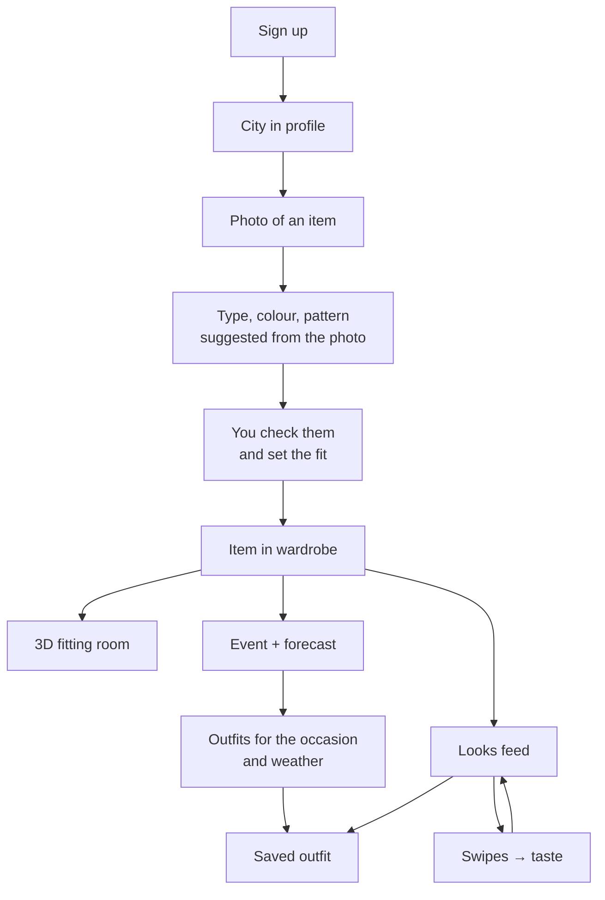

# User flow

You sign up, photograph your clothes, look at them on a 3D mannequin, get outfits for today or for an event, swipe
through an outfit feed and save the ones you like. Below are the steps, with screenshots from the demo account.

## Step by step

### 1. Sign up and log in

Email and password. After login a normal user goes to their profile, an admin goes to `/admin`. In the profile
settings you set your city, which decides the weather for your outfits.

### 2. Wardrobe

Your profile holds your wardrobe: cards with a photo, type, colour and fit for each item. You set the fit yourself
("fits well", "too tight" or "too loose"). The site does not guess it from the photo.

### 3. Adding an item

Click "+ Add item" and pick a photo. In about 2 seconds the browser picks the item type ("Recognized from the photo,
please check"), suggests the main colour and shows what else it saw: plain or patterned, a second colour, sleeve
length. These are suggestions, and you can change any of them. Details in [photo.md](photo.md).

### 4. Fitting room (3D model)

On the "3D model" page the item goes onto a figure wearing the same kind of clothing, and the print from your photo
goes onto the front. You can rotate the figure and change it with sliders: height, chest, waist, hips, shoulders,
arms, legs. There is a Men / Women switch. Details in [mannequin.md](mannequin.md).

### 5. Events and weather

The "Events" page shows the weather in your city now and for the next days. You add events, for example "job
interview tomorrow at 10:00". Each event gets the forecast for its hour and city. "Suggest outfits" on an event, or
the "What to wear today" box, gives you outfits from your wardrobe. Details in [weather-events.md](weather-events.md).

### 6. Outfit feed (Looks)

Outfits are shown one at a time on the 3D mannequin, like a dating app: swipe right if you like it, left if you
don't. Each outfit has a score ("98 match") and a breakdown: occasion, weather, colours, plus style pluses and
minuses. After a few swipes a "Your taste" box appears, and cards get notes like "+0.6 your taste". Under each card,
"Complete the look" suggests one item to buy. Details in [recommendations.md](recommendations.md),
[taste.md](taste.md) and [buy-advice.md](buy-advice.md).

### 7. Saved outfit

You can save an outfit you like. It shows up in your profile and next to the event it was picked for. "Try on in 3D"
opens it in the fitting room.

## Diagram

## Where this is in the code

- Sign up and log in: [register/page.tsx](../../fitcast/frontend/app/register/page.tsx),
  [login/page.tsx](../../fitcast/frontend/app/login/page.tsx), API: [src/auth](../../fitcast/src/auth)
- Profile and wardrobe: [profile/page.tsx](../../fitcast/frontend/app/profile/page.tsx),
  [profile/Wardrobe.tsx](../../fitcast/frontend/app/profile/Wardrobe.tsx)
- Fitting room: [fitting/](../../fitcast/frontend/app/fitting)
- Events and their outfits: [events/page.tsx](../../fitcast/frontend/app/events/page.tsx),
  [events/Outfits.tsx](../../fitcast/frontend/app/events/Outfits.tsx)
- Outfit feed: [looks/page.tsx](../../fitcast/frontend/app/looks/page.tsx)
- Every request the site makes to the API: [lib/api.ts](../../fitcast/frontend/lib/api.ts)
