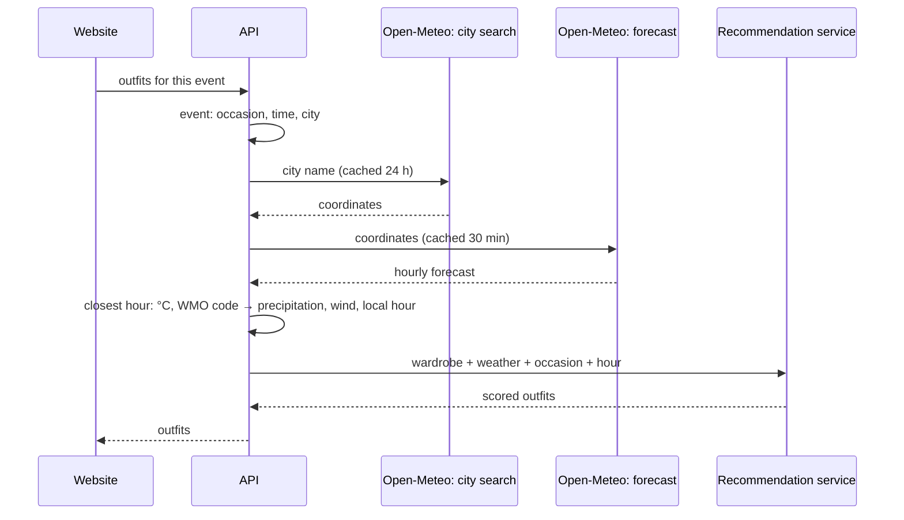

# Weather and events

On the "Events" page you see the current weather and a one-week forecast for your city. You add events: a name, an
occasion (job interview, date, gym…), a date and time, and optionally a different city. Every upcoming event shows the
forecast for its hour right away, and its outfits are picked for that weather and that occasion. The "What to wear
today" box does the same for the weather right now.

## Step by step

### 1. Where the weather comes from

1. The weather comes from [Open-Meteo](https://open-meteo.com), a free service (no key needed, data under CC BY 4.0).
2. First the city name (from your profile or the event) is turned into coordinates. Open-Meteo looks it up.
3. With the coordinates the API asks for the current weather, an hourly forecast and a daily forecast for 16 days:
   temperature, weather code and wind at 10 m height.
4. Only the city name and its coordinates leave the server. The weather service learns nothing about you.
5. Answers are kept in the API's memory: city coordinates for 24 hours, forecasts for 30 minutes. So a page with ten
   events doesn't make ten requests.

### 2. Turning weather into what the recommendations understand

The recommendations need three things: temperature, precipitation and wind.

- **Precipitation.** Open-Meteo gives a standard WMO weather code. It becomes one of four values: none, rain
  (drizzle, rain, showers, thunderstorm), snow (snow, snow showers) or mixed (freezing rain and freezing drizzle).
- **Wind**: in km/h, as is.
- **Local hour**: to know whether it's evening.

### 3. Weather for an event

For an event the API takes the hour of the forecast closest to the start time, in the event's city, or in your
profile city if the event has none. If there is no forecast, the site says why:

- the event is more than 16 days away (the forecast will show up later);
- no city in the event or the profile;
- the city wasn't found;
- the weather service isn't answering.

In these cases no outfits are picked. The site never quietly pretends it's dry.

### 4. How the weather counts

- **Temperature.** Each item type has a "warmth" from 0 to 3 (T-shirt 1, sweater 2, coat 3). Each temperature needs
  a certain total warmth: from +25 °C 1, from +20 2, from +15 3, from +10 4, from +5 5, from 0 6, below zero 7. The
  further an outfit is from that total, the lower its weather score. There are also hard rules: no shorts below
  +10 °C; no sweaters, hoodies, cardigans, jackets or coats from +25 °C; no coat from +20 °C; below +5 °C a jacket or
  coat is a must.
- **Rain and snow.** Without a jacket or coat the weather score drops by 20. Light shoes (white, beige, yellow,
  pink) are left out. They are only worn if there are no other shoes, and then with −5 and a warning.
- **Wind.** Below +15 °C with wind from 20 km/h, the outfit is scored as if it were 2 °C colder (4 °C colder from
  35 km/h). If there's no outer layer on top of that, −8 to weather and the note "windy: a layer would help".
- **Sleeves.** A short sleeve with no layer: −5 below +12 °C, +2 from +25 °C. A long sleeve with no layer from
  +25 °C: −10 to weather.

### 5. How time and occasion count

- **Occasion**: one of 13: casual, gym, business meeting, formal event, outdoors, date, wedding guest, job
  interview, party, theater or restaurant, travel, study, walk with kids. Each one has a dressiness level from 1 to
  5. It also has banned items (job interview: no hoodie, shorts, T-shirt or jeans) and preferred items (job
  interview: blazer, shirt, trousers). Some occasions have a colour palette (business occasions: calm colours) or a
  banned colour (wedding guest: no white). How this turns into points is in
  [recommendations.md](recommendations.md).
- **Time.** After 18:00, for evening occasions (party, theater, date, formal, wedding), a dark outfit gets +3 and an
  all-light one gets −2.

## Diagram

## Where this is in the code

- Weather, WMO codes, cache: [src/weather/weather.service.ts](../../fitcast/src/weather/weather.service.ts)
- Events and their forecast: [src/events/events.service.ts](../../fitcast/src/events/events.service.ts)
- Building the conditions for recommendations: [src/recommendations/recommendations.service.ts](../../fitcast/src/recommendations/recommendations.service.ts)
- Occasions, dressiness, item warmth: [recommendation-service/app/engine/catalog.py](../../fitcast/recommendation-service/app/engine/catalog.py)
- Weather rules and wind: [recommendation-service/app/engine/recommend.py](../../fitcast/recommendation-service/app/engine/recommend.py)
- Evening and sleeves: [recommendation-service/app/engine/factors.py](../../fitcast/recommendation-service/app/engine/factors.py)
- Events page: [frontend/app/events/page.tsx](../../fitcast/frontend/app/events/page.tsx)
